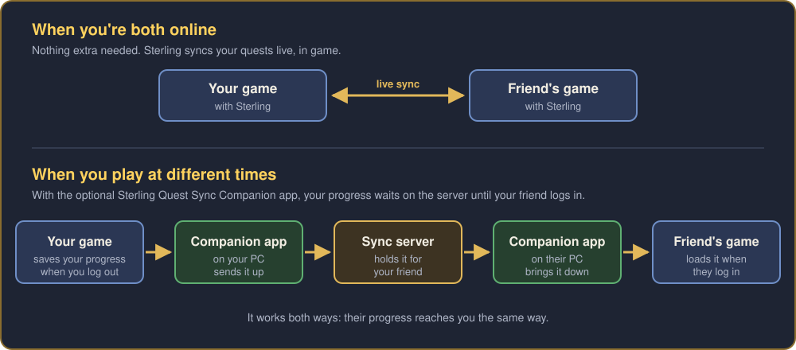
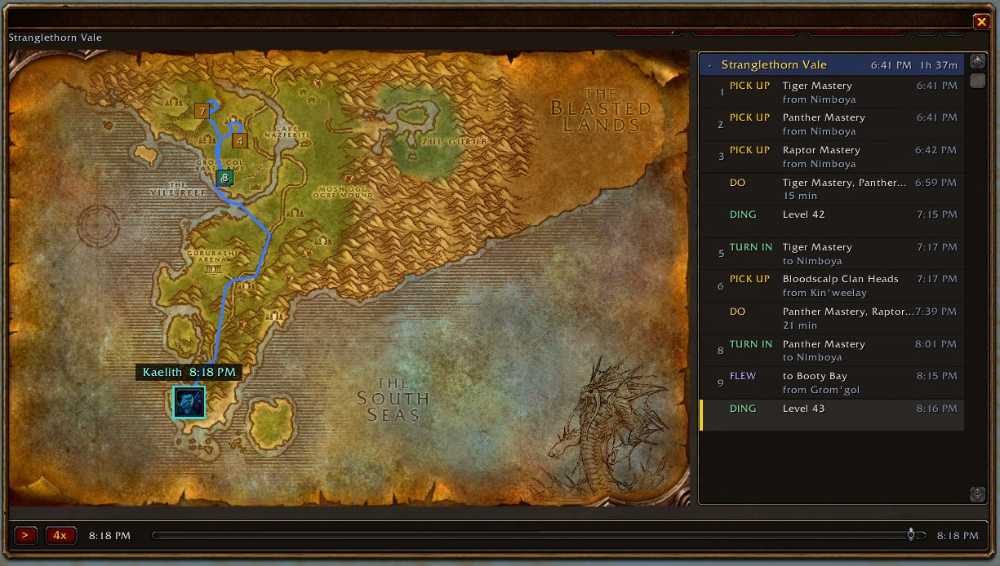
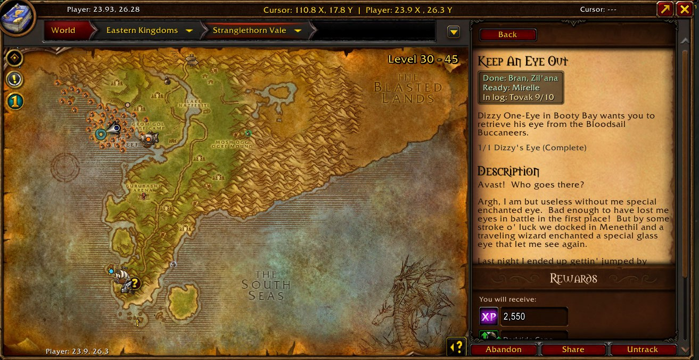
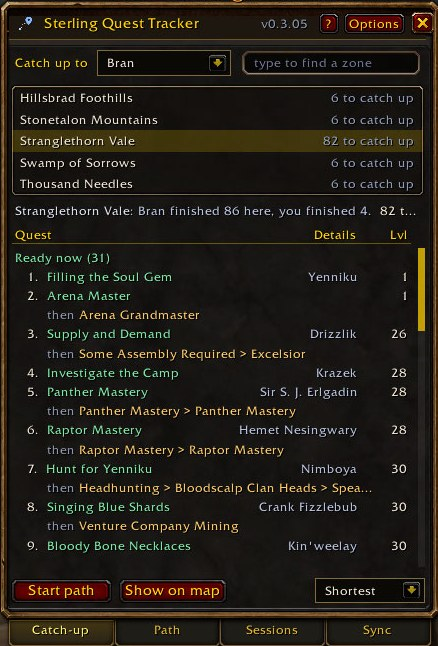
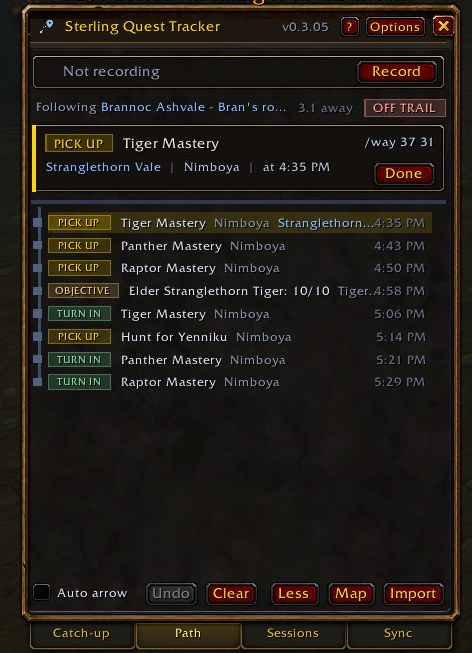
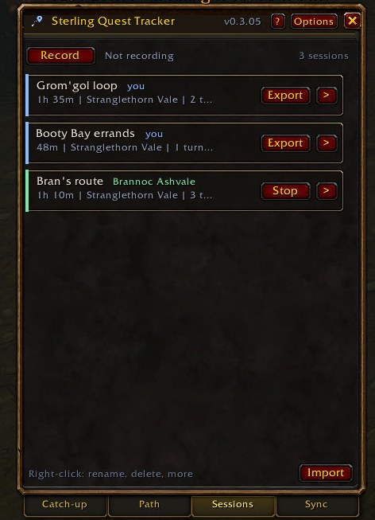
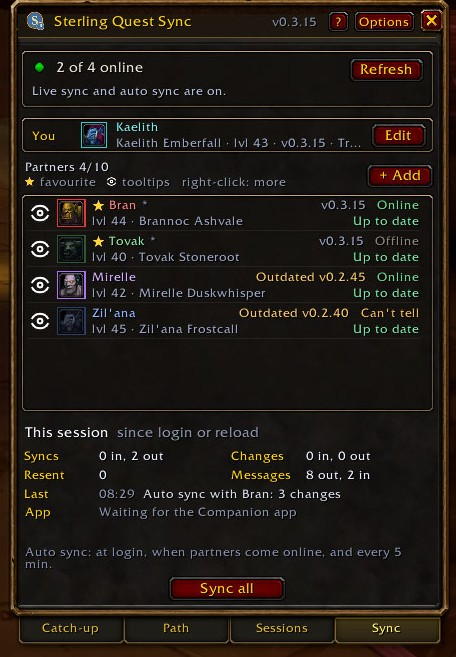

# Sterling Quest Sync

*Formerly Sterling Quest Tracker.*

Quest with friends on WoW Forever without losing track of who has done what.

Sterling began as a little project for me and a few close friends, so we could keep our quests in step while we adventure together, even with different schedules. It's been a lot of fun to build, so I'm sharing it here in case anyone else finds it useful. It's shaped by how we like to play, and it gets updates whenever I can find the time. Ideas and bug reports are always welcome.

> Built by Sterling with the help of Claude, an AI model by Anthropic. The ideas, testing and decisions are mine; much of the code was written with Claude. Everything is tested in game with friends.

## This is Sterling Quest Sync

Sterling is three pieces that work together. You only need the first one.

| Piece | What it does | Where |
|---|---|---|
| **The add-on** | Lives in the game. Syncs quest logs with your friends while you're online together, shows who has done what, plans catch-up routes and records sessions to follow. | This repo |
| **Sterling Quest Sync Companion** (optional) | An optional Windows app that syncs your quests with friends when you play at different times. | [SterlingQuestSync-App](https://github.com/SterlingAddons/SterlingQuestSync-App) |
| **Sync server** | The mailbox the Companion app talks to. A public one is already running, so there's nothing to set up. | [SterlingQuestSync-Server](https://github.com/SterlingAddons/SterlingQuestSync-Server) |

Everything here is open source under the MIT license: the add-on's code is in [`Sterling/`](Sterling), its tests in [`qa/`](qa), and the developer notes in [`docs/DEVELOPMENT.md`](docs/DEVELOPMENT.md).

## The add-on

- **Sync quest logs** with up to 10 friends. See what each of them has in their log and has finished, on tooltips, map pins and in the quest log.
- **Catch up**: pick a friend and a zone and get the quests they did there that you haven't, as a route to follow.
- **Follow a path** step by step, with an arrow on the next stop, a map trail and playback.
- **Record a session** and send it to a friend so they can follow your exact route.
- **Offline sync**: never online at the same time? Use the Companion app, or swap a string over Discord.

### Install

1. Install [WowUp](https://wowup.io) and point it at your WoW Forever folder.
2. Get Addons > **Install from URL**, paste `https://github.com/SterlingAddons/SterlingQuest` and install.
3. Start the game fresh (a `/reload` doesn't pick up new files).

WowUp keeps it updated from then on. You can also download the zip from [Releases](https://github.com/SterlingAddons/SterlingQuest/releases) and unzip it into `_forever_\Interface\AddOns` (the folder is called `Sterling`).

Using the **CurseForge app** instead? Search for Sterling Quest Sync, or open its [CurseForge page](https://www.curseforge.com/wow/addons/sterling-quest-sync). It updates from there too.

### First steps

1. A welcome page opens at your first login. Take the tour, it's three steps.
2. Sync tab > **+ Add**, type a friend's character name. They accept, and you sync whenever you're both online.
3. Catch-up tab: pick the friend and a zone, then **Start path**.

The **?** in the title bar opens Help. `/st` lists the commands. The minimap button opens the window (right-click: map, Shift-click: record), and it follows round and square minimaps.

### A tour

The screenshots use made-up characters: you're Kaelith, with partners Bran, Tovak, Mirelle and Zil'ana.

#### Map

Any session or path opens in its own map window: the trail you took, numbered stops for every pick-up, turn-in, flight and level, and a timeline beside it that you can play back at your own speed.

#### Quest status

Every quest shows where your partners are with it: **Done**, **Ready** (complete, not turned in), **In log** (with their progress, like 9/10) or **Not started**. It's in the quest log, the NPC quest window, on quest givers, and on Questie's map pins. Options > Quest status has six looks for the box, or your own colours.

#### Catch-up

Pick a partner and Sterling lists every zone where they finished quests you haven't, with a count. It opens on the zone you're in. Each quest says whether you can take it now, it's already in your log, it needs an earlier quest first, or why it isn't available, and chains fold into one line ("then A > B"). **Start path** turns it into a route, either the shortest walk or the order your friend did them. Needs Questie.

#### Path

The next step sits on a card at the top (pick up, do, turn in, fly, hearth, note) with its zone, NPC and `/way` spot, and the rest of the route is listed underneath. Steps tick off by themselves as you do them, even out of order; **Done** skips one Sterling can't see. **Auto arrow** points TomTom (or the game's map pin) at each step in turn, and it warns you when you're off the trail.

#### Sessions

**Record** a play session and Sterling keeps where you went and everything you picked up, finished and turned in, plus flights, boats, hearths, dungeons, levels and deaths. **Note** adds a line for whoever follows you. Send a session to a partner or export it as a string; right-click to follow, view on the map, rename, merge, compare or delete (the last five deleted can be restored). Older sessions are packed to keep your saved data small.

#### Sync

Your partners, up to 10. Each row shows their level, version (amber when outdated, red when it can't sync), whether they're online and their sync status (see [What the statuses mean](#what-the-statuses-mean)); hover a row for when you last synced. **Star** up to 5 favourites to keep them on top, and the **eye** chooses whose status shows on tooltips. Right-click for a nickname, compare, sync on/off or remove. **+ Add** finds other Sterling users in your party, guild and friends list and invites them; they accept before anything syncs. **Edit** sets your own name and portrait.

### Options and settings

Look (WoW style or a flat look in your own colours), window size and opacity, how much Sterling says in chat, a colour-blind mode, and every setting for sync, quest status and recording. Everything a command does is also somewhere in the window.

### Works with

Both are optional.

- **Questie**: the Catch-up tab, quest names for finished quests, and status on quest givers and map pins.
- **TomTom**: the arrow to your next step. Without it, Sterling uses the game's own map pin.

## How the desktop app helps

The add-on syncs live whenever you and a friend are online together. [Sterling Quest Sync Companion](https://github.com/SterlingAddons/SterlingQuestSync-App) is an optional Windows app that syncs your quests with friends when you play at different times:

- **Offline sync**: when you log out, the Companion app sends your latest progress to your partners. Their app picks it up before they log in, so Sterling shows your newest quests even if you never overlap.
- **Auto-pairing**: your Sterling partners pair in the Companion app on their own the next time you're both online in game. Pairing codes are only for people who aren't your partners in Sterling yet.
- **Favourites**: the partners you star in game show at the top in the Companion app too, and a change on either side carries over.

Setup and downloads are on the [app's page](https://github.com/SterlingAddons/SterlingQuestSync-App).

### Getting started with the Companion app

1. Install the Companion app from its [page](https://github.com/SterlingAddons/SterlingQuestSync-App).
2. **Exit WoW completely and start it again.** The Companion app adds a small Companion add-on (it shows as **Sterling Quest Sync Companion** in your AddOns list), and WoW only finds new add-ons when the game starts. `/reload` isn't enough.
3. At character select, click **AddOns** and make sure **Sterling Quest Sync** and **Sterling Quest Sync Companion** are both ticked.
4. Log in. If the Sync tab says the Companion add-on isn't loaded, go back to step 2.

### What the statuses mean

The Sync tab and the Companion app use the same words for each partner:

| Status | What it means |
|---|---|
| **Up to date** (green) | You have their latest progress and it's loaded. |
| **Syncing...** | A live sync with them is running right now in game. |
| **New copy, /reload to see it** (gold) | Newer progress arrived through the Companion app but isn't loaded yet. You'll see this in the Companion app; Sterling loads it at your next login or `/reload`. |
| **Paired. Waiting for their next save** | You're paired in the Companion app, but nothing has come from them yet. |
| **Pairs when you're both next online** (gold) | They have the Companion app; pairing finishes on its own the next time you're both in game. |
| **No Companion app** (grey) | You still sync live in game when you're both online. Offline syncing starts once they install the Sterling Quest Sync Companion app. |
| **Not online with you yet** | Sterling hasn't heard from them about the Companion app yet. |

## The server

The Companion app uses my server at `sync.sterlingaddons.com`. It's free for everyone, so nobody needs to run their own. If you'd rather host one yourself, the difficulty is **moderate**: a free Cloudflare account (with a domain on it) and some command-line steps. The [server's setup guide](https://github.com/SterlingAddons/SterlingQuestSync-Server/blob/main/SETUP.md) walks through it.

## Credits

- Questie, by the Questie team
- TomTom, by Cladhaire
- ChatThrottleLib, by Mikk (bundled)
- LibDeflate, by Haoqian He (bundled)
- LibStub (bundled)

## License

[MIT](LICENSE). Made by Sterling for WoW Forever.
